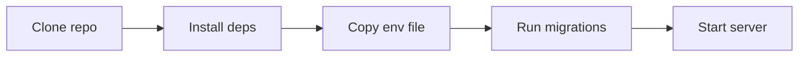
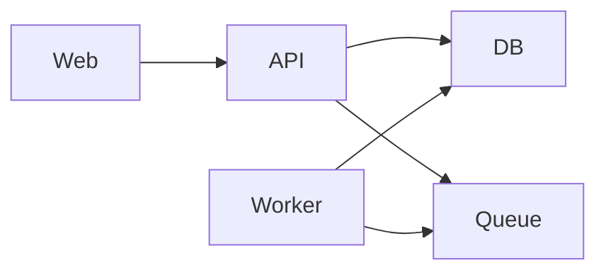
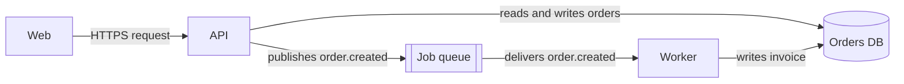
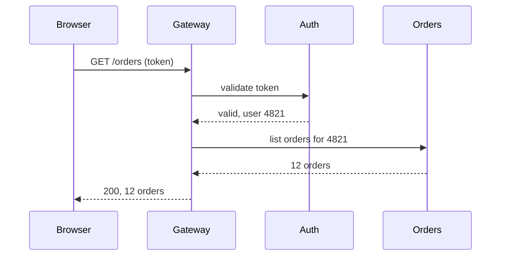

# Worked examples: diagrams and renders

Each example shows a before, an after, and the lesson applied. The instructions are in `references/diagrams.md`.

## 1. A flowchart of a straight line becomes a list

Before:



After:

```markdown
1. Clone the repository.
2. Install dependencies: `make install`.
3. Copy `.env.example` to `.env`.
4. Run the migrations: `make migrate`.
5. Start the server: `make dev`. It prints the local address when ready.
```

Lesson: a sequence with no branch has one dimension, and a numbered list carries it with room for the commands. A diagram earns its place only when it shows a relation a list would lose.

## 2. Unlabelled arrows get meanings

Before:



After:



Text route:

```markdown
- Web sends HTTPS requests to API.
- API reads and writes orders in the Orders DB.
- API publishes `order.created` to the job queue.
- The job queue delivers `order.created` to Worker.
- Worker writes the invoice to the Orders DB.
```

Lesson: label every arrow with what crosses it and point it the way that thing flows. In the before, the Worker-to-Queue arrow pointed against the flow of messages. The text route lets a reader rebuild the diagram without seeing it.

## 3. One crowded diagram becomes an overview and details

Before: a single architecture diagram with 34 boxes: load balancers, services, classes inside two of the services, three databases, queues and cron jobs, connected by 50 lines.

After:

```text
Diagram 1, "What handles a checkout request": 6 boxes
  Browser → Edge → Checkout → Payments → Ledger; Checkout → Notifications

Diagram 2, "Inside Checkout": 7 boxes, titled with the same name as its box in diagram 1

Diagram 3, "Inside Payments": 5 boxes
```

Lesson: one question and one level of detail per diagram, with about a dozen nodes at most. Each group in the overview carries the same name as its detail diagram, so the reader can move between them.

## 4. Accidental styling becomes a fixed vocabulary

Before: boxes in five colours chosen for variety, some rounded and some square with no pattern, solid and dashed lines used interchangeably.

After:

```text
Key
  rectangle        a service we run
  cylinder         a data store
  dashed outline   a third-party system
  solid arrow      synchronous call
  dashed arrow     asynchronous message
  one accent colour: the path of the request under discussion; everything else neutral
```

Lesson: every visual difference must mean one thing, or readers will hunt for a meaning that is not there. Leave a property uniform when it has nothing to encode, and print the key.

## 5. A numbered-arrow box diagram becomes a sequence diagram

Before: four boxes with arrows numbered 1 to 9 going back and forth between them.

After:



Lesson: when order matters as much as who talks to whom, give order its own axis. The reader reads down the page, with no numbers to sort.

## 6. Combinations of conditions leave the flowchart

Before: a flowchart with six decision diamonds for shipping cost, by destination, weight band and membership.

After:

```markdown
The first matching row applies.

| Destination | Weight | Member | Shipping |
| --- | --- | --- | --- |
| domestic | any | yes | free |
| domestic | up to 2 kg | no | 4.00 |
| domestic | over 2 kg | no | 7.00 |
| international | up to 2 kg | any | 12.00 |
| international | over 2 kg | any | 20.00 |
```

Lesson: when the outcome depends on a combination and the order of questions is arbitrary, a decision table lets the reader find their case in one look.

## 7. A diagram gains its sentence and its text route

Before:

```markdown

```

After:

```markdown
A checkout request passes through four services; only Payments talks to the bank.


1. The browser sends the order to Edge.
2. Edge forwards it to Checkout.
3. Checkout asks Payments to charge the card.
4. Payments calls the bank and returns the result.
5. Checkout tells Notifications to send the receipt.
```

Lesson: the sentence before the diagram says what to see in it. The alternative text names the kind of diagram and its point. The numbered walk gives the same structure in text, with the same names.

## 8. A polished mock-up for a structure question becomes a wireframe

Before: a full-colour, pixel-finished mock-up shown to ask "is this the right set of sections for the settings page?". Reviewers comment on the button colour.

After:

```text
┌ Settings ─────────────────────────────────────────┐
│ Profile        name, email, avatar                │
│ Security       password, two-factor, API tokens   │
│ Notifications  email, push, digest frequency      │
│ Billing        plan, invoices, payment method     │
│ Danger zone    export data, delete workspace      │
└───────────────────────────────────────────────────┘
Question for review: are these the right five sections, in the right order?
```

Lesson: match the finish to the decision. Boxes with real labels keep the discussion on structure, and stating the question tells reviewers what feedback is wanted.

## 9. A before-and-after render points at what changed

Before: two full-page screenshots, one above the other, with the note "see the difference".

After:

```text
Side by side, same crop and scale, with numbered callouts:

  (1) The total now appears above the item list.
  (2) "Apply coupon" moved from a link to a visible field.
  (3) The primary button reads "Pay 42.00" where it read "Continue".
```

Lesson: put the two states side by side at one scale, mark each difference, and explain each mark in text so nobody has to hunt.
